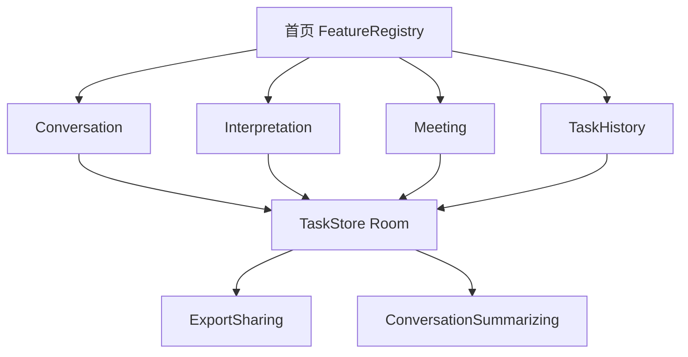

# 02 架构设计 · Android

> ⚠️ **分层与模块注册部分仍与代码一致**；涉及具体引擎名字的地方已过时（本文写 ML Kit / 端侧 `SpeechRecognizer`，实际是 TranslateGemma / SenseVoice）。另外本文写的 `TaskSession`、`LanguageCatalog`、`AppEnvironment`、`DuiyiNavHost.kt` 等名字与代码里的 `ServiceProtocols.kt`、`MainActivity.kt` 不完全对得上。以 [`09-current-state.md`](09-current-state.md) 为准。

目标：在 Android 上复刻 iOS 对译的**可注册功能平台**——不合并面对面 / 同声传译核心逻辑，共用任务、历史、总结、语言能力。

产品规则：[`01-product-prototype.md`](01-product-prototype.md)



---

## 1. 分层

单向依赖。Feature 禁止直接碰 `SpeechRecognizer`、`AudioRecord`、`TextToSpeech`、Room `@Dao`。

```
┌─────────────────────────────────────────────┐
│  App                                        │
│  DuiyiApp · AppEnvironment · 路由 · 首页     │
├─────────────────────────────────────────────┤
│  Features                                   │
│  Home · Conversation · Interpretation       │
│  Meeting · History · Settings · Onboarding  │
├─────────────────────────────────────────────┤
│  Domain                                     │
│  FeatureID · TaskSession · LanguageCatalog  │
│  字幕 / 条款 / 路由（各模块自有模型）         │
├─────────────────────────────────────────────┤
│  Services                                   │
│  Speech · Translation · TTS · Audio         │
│  TaskStore · Summarizer · ExportSharing     │
├─────────────────────────────────────────────┤
│  DesignSystem                               │
│  Tokens · 任务条 · 历史行 · 首页卡片         │
└─────────────────────────────────────────────┘
```

| 层 | 可以 | 不可以 |
| --- | --- | --- |
| App | Hilt 组装、导航图 | 写字幕合并规则 |
| Features | Domain + DesignSystem + 注入的接口 | 直接 `SpeechRecognizer.createOnDeviceSpeechRecognizer` |
| Domain | Kotlin 数据类 / 纯函数 | Android 框架、Compose |
| Services | Domain + Android 系统 API | 引用某个 Feature 的 ViewModel |
| DesignSystem | Compose | 业务状态机 |

与 iOS 的关键差别：iOS 的 `TranslationSession` **必须锚在 View 上**。Android ML Kit `Translator` 可以活在 Service 层（`close()` 随语言对更换）。不要为了「和 iOS 对称」再做一个无意义的 Compose Host。

听写回调发生在主线程（系统约束）。Service 用 `callbackFlow` 切到 `Dispatchers.Default` 做 Assembler，UI 只收已经路由好的 `Utterance`。

---

## 2. 模块注册

```kotlin
enum class FeatureID { FaceToFace, Simultaneous, Meeting }

data class FeatureDescriptor(
    val id: FeatureID,
    val title: (AppLanguage) -> String,
    val subtitle: (AppLanguage) -> String,
    val symbol: ImageVector,
)

interface FeatureEntry {
    fun NavGraphBuilder.destination(environment: AppEnvironment)
}
```

`FeatureRegistry` 只在 App 层列出当前模块。首页 `FeatureRegistry.visible.forEach` 画卡片。新模块：

1. `FeatureID` 加 case  
2. `features/<module>/` 写 Screen + ViewModel  
3. Registry 登记  
4. 实现任务接缝，不要去改 `ConversationViewModel`

**禁止** `if (feature == Meeting)` 塞进 `InterpretationViewModel`。

---

## 3. 任务与存储

### 3.1 Domain

```kotlin
data class TaskSession(
    val id: Uuid,
    val feature: FeatureID,
    val status: TaskStatus,          // Running | PausedListening | Ended
    val startedAt: Instant,
    val endedAt: Instant?,
    val title: String,
    val sourceLanguage: AppLanguage,
    val targetLanguage: AppLanguage?, // 会议记录可空
    val entries: List<TranscriptEntry>,
    val summary: ConversationSummary?,
)

interface TaskStore {
    suspend fun activeTask(forFeature: FeatureID): TaskSession?
    suspend fun startNew(feature: FeatureID, source: AppLanguage, target: AppLanguage?): TaskSession
    suspend fun append(taskId: Uuid, entries: List<TranscriptEntry>)
    suspend fun end(taskId: Uuid, summary: ConversationSummary?): TaskSession
    suspend fun list(filter: FeatureID?): List<TaskSession>
    suspend fun task(id: Uuid): TaskSession?
    suspend fun delete(id: Uuid)
}
```

进行中的任务由模块 ViewModel 持有 `taskId`。字幕先写内存；**每句 settled、暂停、进后台** 时 upsert。结束：`stop()` → 再刷一次 → `end`。

空任务（结束时没有任何非空源文）删除，不进历史。

### 3.2 落盘

Room（见 [`03-tech-choices.md`](03-tech-choices.md)）。`TaskEntity` / `TranscriptEntity` 是存储；`TaskSession` 是 Domain。Store 负责映射。

不把面对面 `PaneState` 整棵树序列化。回看用只读列表，不复用现场 `CaptionLine` 状态机。

---

## 4. 语言目录

| 种类 | 用途 | 机制 |
| --- | --- | --- |
| 界面文案 | 按钮、空状态 | `res/values/strings.xml` + 各 locale |
| 现场语种 | 听写 locale、翻译对、TTS voice | `LanguageCatalog` |

```kotlin
data class LanguageCapability(
    val speechLocale: String,
    val mlKitSource: TranslateLanguage,
    val ttsVoice: String,
    val speech: Boolean,
    val translate: Boolean,
    val speak: Boolean,
)

interface LanguageCataloging {
    val all: List<AppLanguage>
    fun capability(language: AppLanguage): LanguageCapability
    suspend fun speechSupported(language: AppLanguage): Boolean
    suspend fun translationPair(from: AppLanguage, to: AppLanguage): TranslationPairStatus
}
```

启动时用 `SpeechRecognizer.checkRecognitionSupport` 与 ML Kit `DownloadModelIfNeeded` 的本地状态填真实能力。网格读 Catalog，不要写死六枚 Chip。

---

## 5. 各 Feature 与平台的接缝

### 面对面 / 同声传译

ViewModel 增加 `beginTask()` / `endTask()`，依赖 `TaskStore`。`accept` / `fulfill` / `scheduleSpeech` 语义与 iOS 对齐，只在 settled 时 `append`。

设置里的「清屏」只清现场。

### 会议记录

单 locale `speech.start(languages = [source])`。同一句修订合并成一行全文。不做 TTS、不做句级赶译。

### 历史 / 总结 / 导出

```kotlin
interface ExportSharing {
    fun makeTranscriptFile(task: TaskSession, language: AppLanguage): File
}

interface ConversationSummarizing {
    suspend fun availability(): SummaryAvailability
    suspend fun summarize(entries: List<TranscriptEntry>, output: AppLanguage): ConversationSummary
}
```

`SummaryAvailability.DeviceNotEligible` 必须映射到「这台手机不能在本机生成摘要」。

分享在 UI 层用 `ShareCompat` / `Intent.createChooser` 分享 Caches 里的临时 `.txt`。

---

## 6. 导航与生命周期

```
NavHost
  Home
    → Conversation
    → Interpretation
    → Meeting
    → History → TaskDetail
  设置：ModalBottomSheet
  引导：一次过的全屏 destination，完成后 pop
```

`ProcessLifecycleOwner` 进 `STOPPED`：各模块 `stop(listening)`，**不要**自动 `endTask`。

同一时刻只允许一个 `SpeechRecognizing.start`。进另一模块前 `stop()`。

`OnBackPressedDispatcher`：有进行中任务时确认；无任务直接 pop。

---

## 7. 工程结构

```
app/src/main/java/com/duiyi/android/
  app/
    DuiyiApp.kt
    AppEnvironment.kt
    FeatureRegistry.kt
    DuiyiNavHost.kt
  features/
    home/
    conversation/
    interpretation/
    meeting/
    history/
    settings/
    onboarding/
    shared/          # TaskBar, SummarySheet, ExportShare
  domain/
    FeatureID.kt
    TaskSession.kt
    LanguageCatalog.kt
    models/
    routing/
  services/
    speech/
    translation/
    tts/
    audio/
    persistence/     # RoomTaskStore
    summary/
    export/
  designsystem/
    Tokens.kt
    HomeModuleCard.kt
    HistoryRow.kt
```

测试：`TaskStore` 用内存实现；Assembler / ClauseSplitter / LanguageRouter 纯 JVM 单测，不依赖 Robolectric。

---

## 8. 编码约束

- ViewModel：`viewModelScope` + `StateFlow`。不要 `LiveData`。
- 音频 / 识别：Service 接口；实现类用 `@Singleton`，内部 `Mutex` 保证单会话。
- Feature 文件禁止出现 `SpeechRecognizer`、`AudioRecord`、`TextToSpeech` 类型名。
- 新 UI 用系统组件：`AlertDialog`、`SwipeToDismissBox`、系统分享。
- 不在 Composable 里写 Room `@Query`。
- 本阶段不上 Compose 之外的状态框架（不引入 Orbit / MVI 套件）。Hilt + ViewModel 已够。
- 竖屏：`android:screenOrientation="portrait"` 写在三个现场 Activity 或单一 Activity 的 Manifest。不要靠传感器解锁。
