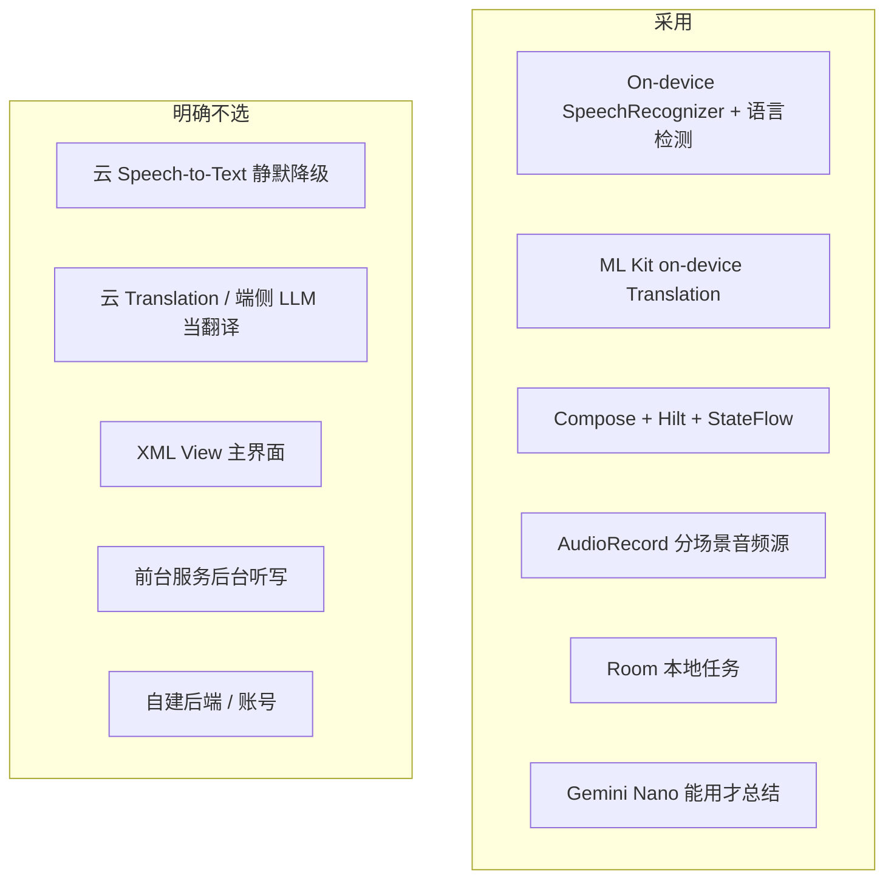

# 03 技术选型 · Android

> ⚠️ **本文写于实现之前，翻译一节的结论已被推翻。** 真机（荣耀 ALP-AN00）上 ML Kit 这条路没有走下去，实际实现是 **llama.cpp + TranslateGemma 4B**（翻译）与 **sherpa-onnx SenseVoice int8 + Silero VAD**（荣耀机听写）。
>
> 本文保留作为**选型推演记录**：第 1 节的 UI / 状态 / DI / 存储 / TTS / 音频 / 导出 / 最低系统各条仍然成立；第 3 节（翻译）与第 2 节（语音）中关于「ML Kit」「端侧 SpeechRecognizer」的结论请对照 [`09-current-state.md`](09-current-state.md) 第 1 节的偏差表阅读。

部署目标：**Android 14（API 34）+**，targetSdk 35。真机优先。
设备：能装本 App 的手机；**Gemini Nano 不是门槛**。中端机必须完整能用听写、翻译、任务、导出。

---

## 1. 决策总表

| 问题 | 选择 | 不选 | 原因 |
| --- | --- | --- | --- |
| UI | Jetpack Compose + Material 3 组件、自有 Tokens | XML + ViewBinding 主界面 | 倒字、分屏、状态驱动字幕是声明式强项；系统分享 / 对话框都是 Compose 一等公民 |
| 状态 | `ViewModel` + `StateFlow` | 本阶段 Orbit / MVI 套件 | 三个模块体量不够再引框架 |
| DI | Hilt | 手写单例墙；Koin | 与 Android 组件生命周期文档路径一致 |
| 语音 | **`createOnDeviceSpeechRecognizer`** + `EXTRA_ENABLE_LANGUAGE_DETECTION` + Android 14/15 语言切换 extras | `RecognizerIntent` 弹系统 UI；云 STT；默认 `createSpeechRecognizer()`（可走网络） | 产品承诺本机；系统 UI 无法做倒字板 |
| 切句 | 部分结果 + 静音窗口（`COMPLETE_SILENCE`）+ 自写 Assembler | 只等 `onResults` | 对话里 final 来得晚 |
| 面对面语种 | 单引擎多语种 + 检测回调当路由键 | 两个 SpeechRecognizer 并行 | 系统通常只允许一个识别会话；双开会 `ERROR_RECOGNIZER_BUSY` |
| 翻译 | **ML Kit Translation** 预下载语言包 | Google Cloud Translation；自训 NLLB | 六语都有端侧包、无密钥、可离线 |
| TTS | `android.speech.tts.TextToSpeech` | 云 Neural TTS | 系统离线声；缺声则关读出 |
| 音频 | `AudioRecord`：面对面 `UNPROCESSED`/`VOICE_RECOGNITION`；同传读出 `VOICE_COMMUNICATION` | `MediaRecorder`；随意 `VOICE_CALL` | 与 iOS measurement / voiceChat 二分对应 |
| 存储 | **Room** | DataStore 存全文；Realm | 列表、增量、杀进程恢复；测试可换内存 |
| 同步 | 只本地 | Drive / 自建 | 隐私与冲突 |
| 总结 | ML Kit GenAI Summarization（Gemini Nano）能用才用 | 假装所有机型都能总结；偷偷调 Gemini 云 API | 与 iOS「13 说没有」同一诚实原则 |
| 导出 | Caches `.txt` + 系统分享 | 微信 SDK | 审核与定位 |
| 最低系统 | API 34 | API 26 + 旧识别 | 端侧多语种识别、语言检测、on-device recognizer 从 33 起，34 上语言切换才够用 |
| 架构套件 | 手动协议 + Hilt | Clean 架构模板生成器 | 分层已够 |

听写无法做到 iOS `SpeechAnalyzer` 双 Transcriber 的质量，见 [`06-compromises.md`](06-compromises.md)。

---

## 2. 语音：为什么是 On-device SpeechRecognizer

Android 没有公开的、与 `SpeechAnalyzer` 对等的「多 Transcriber 挂在同一 Analyzer」API。可选方案：

| 方案 | 离线 | 长时 | 双语句话 | v1 |
| --- | --- | --- | --- | --- |
| `createOnDeviceSpeechRecognizer` + 语言检测 / 切换 | 是（若设备声明支持） | 需自己续会话 | 系统自动切换，不是双路 | **采用** |
| `createSpeechRecognizer`（默认） | 不保证 | 视 Google App | 可能上云 | 否，违反本机承诺 |
| 系统 `RecognizerIntent` 弹窗 | 视设备 | 否 | 否 | 否，无法做倒字 UI |
| sherpa-onnx / Whisper.cpp | 是 | 是 | 可跑双语模型 | v1.1 后备，体积与发热另评估 |
| 云 STT | 否 | 是 | 是 | 否 |

采用路径：

1. 启动检查识别服务。荣耀 / 华为：不要把 `isOnDeviceRecognitionAvailable == true` 当成能出字；默认引擎对第三方经常无回调。有 Google 应用则绑定 `GoogleRecognitionService`，且不设 `EXTRA_PREFER_OFFLINE`（包未装时会一直无字幕）。
2. Pixel 等：`isOnDeviceRecognitionAvailable` 且 `installedOnDeviceLanguages` 含中英 → 端侧识别 + `EXTRA_PREFER_OFFLINE`。
3. `startListening` extras：
   - `EXTRA_PARTIAL_RESULTS = true`
   - 始终带 `EXTRA_LANGUAGE`（荣耀缺这个经常直接无结果）
   - 面对面语言切换 extras **仅 Google / 三星**；荣耀用语种脚本推断
   - 荣耀不设 `COMPLETE_SILENCE` 自定义窗口
   - 同传 / 会议：只设源语言；不要用 OEM 的 `DETECTED_LANGUAGE` 把整句丢掉
4. 识别会话被系统掐断（常见 60s 量级或 `ERROR_SPEECH_TIMEOUT`）：同一 `taskId` 自动 `startListening` 续上，UI 不结束任务。Assembler 把续上的第一包当新 utterance 或 continuation，按文本规则判定。
5. 开始听写时不要 `checkRecognitionSupport`：荣耀上它会占住唯一的识别器，随后真正的 `startListening` 一直无回调。

`SpeechRecognizer` 方法必须在主线程调用。Engine 内部 `Main.immediate` 调系统，结果 `callbackFlow` 发出。

不打开 `ignores` 类隐藏 API。不绑定特定厂商识别服务 ComponentName（三星 / 小米差异用能力检测消化，不写死）。

---

## 3. 翻译：为什么是 ML Kit

| 方案 | 离线 | 六语 | 工程 | v1 |
| --- | --- | --- | --- | --- |
| ML Kit Translation | 下包后离线 | zh / en / ja / ko / th / vi **都有** | 中 | **采用** |
| ML Kit Chinese 专用 | 是 | 仅中英向 | — | 不够 |
| 云 Translation | 否 | 是 | 密钥 | 否 |
| 端侧 LLM 当翻译 | 视设备 | 不稳定 | 高 | 否 |

实现要点：

- 每种方向一对 `Translator`（`zh→en` 与 `en→zh` 是两个）。面对面预下载双向；同传只下当前方向。
- `downloadModelIfNeeded()` 在引导页，进度条真实来自 `RemoteModelManager`。
- 中间结果节流：同一 `utteranceId` 合并，≤ 3 次/秒，final 必送。
- 换语言对：`close()` 旧 translator，再创建。不要长期持有六语全排列（最多 6×5=30 个包，引导只下用户实际选的）。

模型与「Google 翻译」App 不一定共享。用户可能下过系统翻译，本 App 仍可能再下 ML Kit 包。引导文案写「对译需要下载离线翻译包」，不要写「与系统共享、无需下载」。

---

## 4. 语种识别：为什么不单独上 LID 模型

面对面路由需要知道「这一句是中文还是英文」。

| 方案 | 延迟 | v1 |
| --- | --- | --- |
| 系统 `onLanguageDetection` | 低 | **主票** |
| 文本脚本（汉字比 / 拉丁比） | 低 | **第二票**，与 iOS Assembler 相同 |
| `NLClassifier` / 自带 ECAPA | 中 | 不做 |
| 用户按住「我在说」 | 0 | 否决 |

融合：检测回调语种 + 脚本分；都低则保持 `lastLanguage`。短句「好」「OK」以脚本与上一句锁定为准。

---

## 5. 音频会话

| 模式 | `AudioSource` | `AudioManager` mode | 说明 |
| --- | --- | --- | --- |
| 面对面 | `UNPROCESSED`，失败则 `VOICE_RECOGNITION` | `MODE_NORMAL` | 少处理，避免 AEC 把对面当回声 |
| 同传 · 只字幕 | 同上 | `MODE_NORMAL` | |
| 同传 · 读出 | `VOICE_COMMUNICATION` | `MODE_IN_COMMUNICATION` | 要 AEC 压 TTS |

路由：`AudioDeviceCallback` 是耳机真源。仅 `TYPE_BUILTIN_SPEAKER` → `canSpeakWithoutEcho = false`。有线、蓝牙 SCO/A2DP、USB、助听器 → 真。

不用 `FOREGROUND_SERVICE_MICROPHONE`。离开前台即停听写。

蓝牙：允许，面对面场景设置里提示「请把手机平放在两人中间」。

`FLAG_KEEP_SCREEN_ON` 仅 listening。

---

## 6. 存储：Room

任务 = 一条会话 + 多条字幕 + 可选摘要。

| 方案 | 不选原因 |
| --- | --- |
| DataStore / JSON 文件 | 列表、部分更新、损坏恢复要手写 |
| 把整场会塞进一个 TEXT blob | 回看和增量保存痛 |
| SQLiteOpenHelper 手写 | 与 Room 重复一套 |

要点：`TranscriptEntity` 独立表，按 `taskId` 拉取。schema 一次给齐。测试用 in-memory Room 或 fake store。

---

## 7. 总结：三种设备状态

对应 iOS 的 Apple 智能三态：

| 事实 | 用户看到的 |
| --- | --- |
| `FeatureStatus.AVAILABLE` | 生成摘要，脚注「由 Gemini Nano 在本机生成」 |
| 可下载 / 准备中 | 模型还在准备；仍可导出 |
| 设备无 AICore / 不支持 | **这台手机不能在本机生成摘要** |

禁止对不支持设备使用「打开即可」。禁止后台调用 Gemini 云 API 冒充本机。

输入截断与 iOS 一样：单条任务建议 2 万字；GenAI 还有约 4000 token 上限，超了先截近期或提示导出。

---

## 8. 界面与系统能力

| 能力 | 用法 |
| --- | --- |
| Compose `Modifier.rotate(180f)` | 对方整块容器旋转 |
| `android:screenOrientation="portrait"` | 正面朝上禁止自动旋转把两侧对调 |
| Sharesheet | 导出 txt |
| Predictive Back | 模块 → 首页 |
| `AudioDeviceCallback` | 读出开关真源 |

最低能力检测顺序：

1. `isOnDeviceRecognitionAvailable`
2. 所选语种 `checkRecognitionSupport` 端侧已安装
3. ML Kit 语言包已下载或可下载
4. 麦克风运行时权限

任一硬性失败 → 引导页说明，不进主界面空转。TTS 声缺失只禁用读出。

---

## 9. 性能预算

桌面连续对话按 **30–45 分钟** 设计。

| 项目 | 预算 |
| --- | --- |
| 部分结果刷新 | UI 只改字符串 |
| 送去翻译 | ≤ 3 次/秒，按 utteranceId 合并 |
| 面对面历史字幕 | 每侧 2 行 |
| 同传历史 | 内存 50 条，界面懒加载 |
| 音频 buffer | 16 kHz / 16 bit / mono，转完即弃 |
| 识别中断续上 | < 300 ms 内重新 `startListening` |

降级顺序：停 volatile 翻译（只译 final）→ 面对面关闭语言自动切换、改为用户点对调 → 提示过热请暂停。不要为了续听改前台服务。

---

## 10. 隐私与审核

- 默认不写录音、不上云、不进分析 SDK。
- 权限文案与 Play 数据安全表一致：「音频仅在设备上用于转写」。
- ML Kit 模型下载需要一次性网络，之后离线。这一点在引导页写明。
- 不申请 `QUERY_ALL_PACKAGES`。
- targetSdk 35 麦克风：只在可见 Activity 使用。

---

## 11. 风险

| 风险 | 缓解 |
| --- | --- |
| 厂商识别服务语言包不一致 | Catalog 真机探测；灰掉并给「去系统设置下载」 |
| 会话被 60s 掐断造成句裂 | 自动续听 + Assembler continuation |
| 语言切换丢词（Android 14 已知） | 用 15 的 switch extras；双端间隙靠脚本锁定 |
| ML Kit 与系统翻译包不共享 | 引导如实要下载体积 |
| Gemini Nano 覆盖极窄 | 总结三态文案；导出永远可用 |
| `UNPROCESSED` 部分机型不可用 | 回退 `VOICE_RECOGNITION` |
