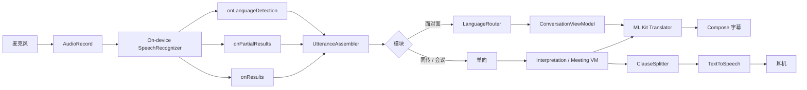

# 04 实现原理 · Android

把「麦克风里的 PCM」变成「正确一侧屏幕上的译文」，可选再变成「耳机里的一句朗读」。本节是运行时，不是目录结构。

---

## 1. 总流水线



同一时刻只有一个 ASR 会话。切模块先 `stop()` 再 `start()`。

---

## 2. 听写会话

### 2.1 为什么还要自己采音

`SpeechRecognizer.startListening` 默认自己开麦。面对面要控制音频源（避免 AEC 压对面），同传读出要切 `VOICE_COMMUNICATION`。v1 分两档：

- **档 A（先做）**：让 `SpeechRecognizer` 自采，音频源不可控。面对面远场会差一截，但能先跑通字幕。
- **档 B（M2 真机后）**：若设备支持，用 `EXTRA_AUDIO_SOURCE` / 厂商扩展；不行则保持档 A，并在设置说明「平放桌面、靠近说话人」。

不要在 v1 自己 `AudioRecord` 再喂给 `SpeechRecognizer`——公开 API 没有稳定的 buffer 注入口（那是 iOS Analyzer 的能力）。自喂只在接入 sherpa-onnx 后备时才出现。

### 2.2 续会话

```
listening
  → onError(SPEECH_TIMEOUT / CLIENT / NO_MATCH)
  → 若 task 仍进行中且权限仍在：300 ms 后 startListening(同一 extras)
  → Assembler 不重置 lastLanguage
  → UI 不闪「已暂停」
```

用户点暂停或结束：不再自动续。

`onEndOfSpeech` 之后系统常会停。会议记录必须续，否则一场 10 分钟会变成十几段。

### 2.3 部分结果与 final

映射到 Domain `Utterance`：

| 回调 | `isFinal` | 用途 |
| --- | --- | --- |
| `onPartialResults` | false | 刷新 live 字幕、节流送译 |
| `onResults` | true | settled；面对面路由定死这一句 |
| `onLanguageDetection` | — | 更新 Assembler 的 claimed language |

没有 iOS `SpeechDetector`。静音切句用 extras：`EXTRA_SPEECH_INPUT_COMPLETE_SILENCE_LENGTH_MILLIS ≈ 1100`（同传切句 / 朗读点），面对面可略长，避免对面换气被切碎。

---

## 3. UtteranceAssembler（从 iOS 移植）

纯 Kotlin，JVM 单测。职责：

1. 丢掉与 claimed 语种脚本明显不符的包（英引擎吐出大段汉字则弃）。
2. 短窗口抑制另一语种抢话（对插话）。
3. 同一句 continuation / refinement 不换 `utteranceId`。
4. 静音或 final 后 `beginNextUtterance`。

面对面：检测语种 + 脚本分选出 winner，再交给 `LanguageRouter`。

同传：只收源语言包，Assembler 几乎透传，保留是为了续会话时的 continuation。

会议：`SpokenText.isContinuation` 把同一句修订合并进全文最后一行，不堆行。

移植时以 iOS `UtteranceAssembler` / `SpokenText` 测试向量为准，三端共享同一组黄金句（放在各工程 `testdata/utterances.json`）。

---

## 4. 面对面路由

```
winnerLanguage == userLanguage → 译文打到 peer 屏（上，180°）
winnerLanguage == peerLanguage → 译文打到 user 屏（下）
```

翻译方向：源 = winner，目标 = 另一侧语言。双向 `Translator` 常驻（用户所选那一对）。

UI：每侧只保留 live 一行 + previous 一行。更早的进任务 Store，不进现场 pane。

---

## 5. 翻译节流

```kotlin
fun shouldTranslate(now: TimeMark, last: TimeMark, isFinal: Boolean): Boolean {
    if (isFinal) return true
    if (last.elapsedNow() < 40.milliseconds) return false   // 首包例外在 VM 里
    return last.elapsedNow() >= 90.milliseconds
}
```

同一 `utteranceId` 的 in-flight Job 取消，只留最新。ML Kit 取消不会抛 iOS 那种 14/20，但不要让旧译文覆盖新 final：用 `generation` 计数。

---

## 6. 同传朗读

`ClauseSplitter` 纯函数，规则与 iOS 相同：

1. 译文以 `，。！？；;:!?` 结束 → 整段可朗读  
2. 静音切句 → 无论有无标点都可朗读  
3. volatile 且无标点 → **不朗读**  
4. 同一 utterance 变长：只读**新增后缀**

队列上限 2。超出丢最旧。`TextToSpeech.speak(..., QUEUE_FLUSH)` 只在「丢掉积压跟上说话人」时用；正常 `QUEUE_ADD`。

`UtteranceProgressListener` 在 Service 里转 Flow，ViewModel 再取下一条。禁止在 Composable 里持有 TTS。

拔耳机：`AudioDeviceCallback` → `stopAndClear`，开关打回关。

---

## 7. 音频策略（实现）

`AudioSessionPolicy` 单例：

```kotlin
enum class AudioUseCase { FaceToFace, InterpretationCaptions, InterpretationVoiceOut }

interface AudioSessionConfiguring {
    suspend fun activate(useCase: AudioUseCase)
    suspend fun deactivate()
    fun currentRoute(): AudioRouteSnapshot
    fun routeChanges(): Flow<AudioRouteSnapshot>
}
```

`canSpeakWithoutEcho` 只看输出设备类型，不看用户开关。用户打开读出但路由是扬声器 → VM 拒绝并出文案。

切换面对面 ↔ 同传读出：先 `tts.stop()`，再 `activate`，再重启 ASR（音频源变了，不重启会继续用旧会话）。

---

## 8. 任务落盘点

| 事件 | 写 Store |
| --- | --- |
| settled 句 | upsert 该 `TranscriptEntry` |
| 暂停 | 刷内存稿 + `status = pausedListening` |
| `ON_STOP` | 同暂停 |
| 结束 | 再刷 + `status = ended`；空稿则 delete |
| 清屏 | **不**删 Store，只清现场 |

杀进程恢复：启动时 `status != ended` 列在首页。点入模块 `restore()`，不自动开麦。

---

## 9. 模型准备

引导顺序：

1. 麦克风权限（失败 → 失败态，给系统设置 Intent）
2. 端侧识别可用性
3. 当前语言对 ML Kit `downloadModelIfNeeded`（可并行双向）
4. TTS `getVoices()` 探测，只影响读出开关默认值

进度：翻译包下载用真实百分比。识别语言包若必须去系统「语音识别」设置，按钮打开该设置，本 App 不做假进度。

---

## 10. 并发模型

| 组件 | 线程 |
| --- | --- |
| SpeechRecognizer 调用 | Main |
| Assembler / Router / Splitter | Default |
| ML Kit translate | ML Kit 内部线程，结果回 Main |
| Room | 自带后台；Store 接口 `suspend` |
| ViewModel | Main.immediate 收 UI 事件 |

禁止在主线程做脚本统计以外的重活。禁止 ASR 与 TTS 在无 Mutex 下同时 `stop`/`start`。

---

## 11. 错误到文案

| 条件 | 文案方向 | 恢复 |
| --- | --- | --- |
| 无端侧识别 | 这台手机还不能离线听写 | 停在引导 |
| 语种未安装 | 灰掉 Chip，去系统设置下载 | 不下也不得选 |
| 麦克风拒绝 | 去系统设置打开麦克风 | 设置页按钮 |
| 识别中断且续听失败 | 轻点继续 | 不结束任务 |
| 无耳机却开读出 | 戴上耳机再读出译文 | 关开关，字幕继续 |
| 无该语言 TTS | 这台设备没有该语言的朗读声 | 仅字幕 |
| Nano 不可用 | 这台手机不能在本机生成摘要 | 导出 |

不要用 Toast 报内部 `ERROR_CLIENT`。日志 `DuiyiLog`，Release 不打字幕内容。
