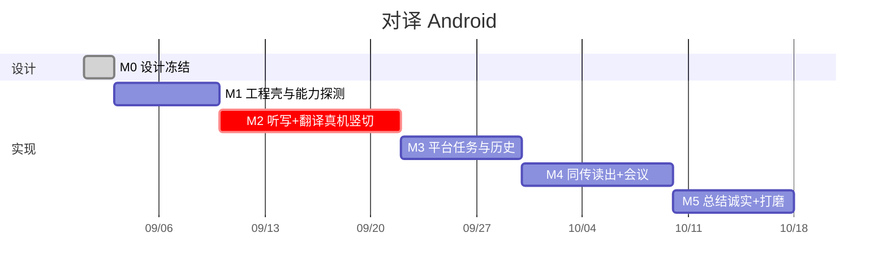

# 07 落地路线图 · Android

原则：**先证明端侧听写 + ML Kit 在目标真机上能跑通一句中英，再铺平台壳，最后才是同传读出和会议长时。** 不要先做完首页再发现合格设备列表只剩 Pixel。

当前仓库：M1–M5 的代码路径已按本文落地（引导、面对面、任务/Room、同传读出、会议全文、诚实总结、导出）。**Honor ALP-AN00 真机过关仍须插上手机跑一遍**；无 GMS 厂商引擎是后续替换 `Translating` / `SpeechRecognizing`，不是 v1 范围。

按 1 名熟悉 Android 的工程师 + 可借用 iOS 对译产品规则估算，约 **8 周**到可演示：Pixel 8 上面对面轮流说、同传耳机读出、会议 10 分钟回看、导出分享、无 Nano 机型总结文案正确。



---

## 总览

```
W1     工程、Tokens、引导、能力探测（尚无可靠字幕）
W2–W3  面对面竖切：部分结果 → 路由 → ML Kit → 倒字板
W4     首页 + 任务 + Room 历史
W5–W6  同传模块 + 读出策略 + 会议全文
W7–W8  总结三态、导出、无障碍、真机清单
```

| 里程碑 | 产出 | 过关标准 |
| --- | --- | --- |
| M0 | 01–07 文档 + 原型 | 任务语义、不云降级、无 GMS 不合格 无争议 |
| M1 | 可安装包、引导、Catalog 探测 | Pixel 上能看出「听写 / 翻译是否已装」 |
| M2 | 面对面主路径真机 | 轮流中英各两句，译文打到正确一侧 |
| M3 | 新任务 / 结束 / 杀进程恢复 | 结束一条，杀进程再开，历史还在 |
| M4 | 同传 + 会议 | 耳机读出；无耳机拒绝；10 分钟会能回看 |
| M5 | 总结文案 + 导出 + 打磨 | 无 Nano 机不出现「请打开 AI」 |

---

## 第 0 天 · 设计冻结（当前）

- [x] 与 iOS 平台同一套任务 / 模块规则  
- [x] 选型：on-device SpeechRecognizer、ML Kit、Room、Nano 能用才总结  
- [x] 无 GMS 不作为 v1 合格设备  
- [ ] 用 [`../prototype/platform.html`](../prototype/platform.html) 点一遍  

出口：不再改「禁止静默云识别」「倒字旋转」「无耳机不读出」。

---

## M1 · 工程壳与能力探测（约 1 周）

1. Gradle、Hilt、Compose Navigation、Tokens、竖屏。  
2. `LanguageCatalog` + `checkRecognitionSupport` + ML Kit 模型状态。  
3. 引导：语言 → 权限 → 下载翻译包（可先假进度，M2 换真的）。  
4. 首页四张卡片可进占位屏。  
5. 不合格设备失败态文案。

验收：两台机器对比——Pixel（应显示端侧语言列表）与一台无端侧识别的机（应停在引导）。

风险：CI 无真机。M1 验收就是真机。

---

## M2 · 听写 + 翻译竖切（约 2 周，关键路径）

1. `SpeechRecognizing` 封装：部分结果、final、语言检测、自动续听。  
2. 移植 `UtteranceAssembler` + 黄金测试。  
3. `LanguageRouter` + 双 Translator。  
4. `ConversationView`：倒字、中间钮、语言条。  
5. 节流翻译、generation 防旧译文覆盖。  
6. 真机：中英轮流、插话、续听不断任务。

验收：

- 用户说中文，上半屏出英文。  
- 对方说英文，下半屏出中文。  
- 关网后（模型已下）仍可译。  
- 打开 Log 确认没有连到 `speech.googleapis.com` 一类云识别。

失败则停：不进入 M3 堆历史。可评估 sherpa 后备，但那是范围变更，需单独决策。

---

## M3 · 任务与历史（约 1 周）

1. Domain `TaskSession` + Room + 内存 Fake。  
2. `TaskBar` 接到面对面。  
3. 暂停 / 后台停听写不停任务。  
4. `HistoryView` 列表、筛选、删除、详情只读。  
5. 未结束恢复。  
6. 测试：空任务不进历史；删除一条不影响另一条。

验收：开任务 → 说两句 → 结束 → 历史有全文；杀 App 再开，进行中还在。

---

## M4 · 同传与会议（约 1.5 周）

1. `InterpretationViewModel`：单语、单向译、不自动开听。  
2. `AudioSessionPolicy` + 耳机判定。  
3. `ClauseSplitter` + TTS 队列上限 2。  
4. `MeetingViewModel`：全文合并、2 万字提示。  
5. 切模块 stop 引擎。

验收：戴蓝牙或有线耳机读出一句；拔掉立刻停；会议 10 分钟回看能从头读到尾。

风险：蓝牙 SCO 打坏 ASR → 关读出保字幕，记入已知问题，不挡 M4 过关。

---

## M5 · 总结、导出、打磨（约 1 周）

1. `SummaryAvailability` 三态文案。  
2. `TranscriptExportService` + Sharesheet。  
3. 动态字体、TalkBack、挖孔 insets、预测性返回确认。  
4. Catalog 收口；strings 各 locale。  
5. 真机清单签字。

验收：一台无 Nano 的手机打开历史，看到「不能在本机生成摘要」，分享面板能发出带文字稿的 txt。

---

## 真机清单（M5 强制）

| 设备 | 看什么 |
| --- | --- |
| Pixel 8/9 | 端侧多语种、语言检测、Nano 总结（若有） |
| 一台 Android 14 三星 | OEM 识别、TTS、蓝牙 |
| 一台无端侧识别机 | 引导失败文案 |
| 挖孔 + 平放 | 倒字与误触 |

---

## 依赖关系

```
M1 ──► M2 ──► M3 ──► M4 ──► M5
              └── 导出接口可先空，M5 填满
```

不要并行「重构 Tokens」和「改 Assembler」。字幕质量问题单开，不塞进平台周。

---

## 本阶段不做

- 无 GMS / HMS 双栈  
- 云 STT / 云翻译  
- 前台服务后台听写  
- 说话人分离、会议现场同传  
- sherpa-onnx 主路径（仅当 M2 在目标机失败，另开决策）  
- 折叠屏、平板、Wear  
- 新的现场语种  
- iCloud / 账号 / 录音文件  
- 微信 SDK  
