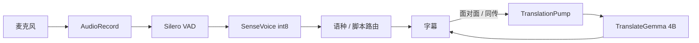

# 08 端侧大模型：工作原理、已做优化、简化场景后的空间

本文只描述 **Android 对译** 里真正跑在手机上的大模型路径：TranslateGemma 4B。听写（SenseVoice）是另一个更小的语音模型，不是大模型。

测量环境：Honor X50 GT（ALP-AN00），骁龙 8+ Gen 1，16 GB，2026-09-07 真机自检。

系列位置：产品 [`01`](01-product-prototype.md) · 架构 [`02`](02-architecture.md) · 本文讲翻译推理。

---

## 一、端侧大模型如何工作

### 1. 它在产品里干什么

对译有四个入口。和 TranslateGemma 的关系：

| 功能 | 听写 | 大模型 |
| --- | --- | --- |
| 面对面 | SenseVoice，中英都听 | 中→英、英→中各译一次，写到对面那一侧 |
| 同声传译 | SenseVoice，锁现场语种 | 源语 → 目标语，覆盖字幕；可选系统 TTS 读出 |
| 会议记录 | SenseVoice | **不翻译**，只留转写 |
| 任务历史 | 无 | 无（读已存文本） |

大模型不碰麦克风。它吃的是已经切好的一句文字，吐出另一句文字。

荣耀机听写走 sherpa-onnx + SenseVoice int8 + Silero VAD；翻译走 llama.cpp + TranslateGemma 4B Q4。两者都在 CPU 上，会抢核，但不能混成一个模型。

会议的 `MeetingViewModel` **没有**注入 `Translating`，点「听」不会再 `prepare`。但引导页 `OnboardingViewModel` 会下载并预热两个语言对；`GemmaTranslator` 是进程级 Hilt 单例，引导完成后 4B 可能已经常驻。所以「会议不翻译」≠「进程里一定没有 Gemma」。



### 2. 模型架构

权重文件：`files/translategemma-4b-it-q4/translategemma-4b-it.Q4_K_M.gguf`，`GemmaModelSpec.EXPECTED_BYTES = 2_489_909_760`。

这是 Google **TranslateGemma 4B Instruct**，底座是 **Gemma 3** 的**解码器-only Transformer**（causal LM），不是经典 NMT 的编码器-解码器：

| | 经典 NMT（Marian / Transformer-base 翻译） | 本程序 |
| --- | --- | --- |
| 结构 | Encoder 读源句，Decoder 写译文，两边交叉注意力 | 只有 Decoder：源句和指令都写成一段 prompt |
| 输入 | 源句 token | 对话模板 + 源句 + `<start_of_turn>model` |
| 输出 | 目标语 token | 在 model 回合 greedy 续写，直到结束符 |
| 训练 | 平行语料 seq2seq | Gemma 3 语言模型 + 翻译指令微调 |

工作方式可以想成：把「你是英译中译员 + 请翻译：How are you.」当成一篇未写完的文章，让模型把下一句补成「您好吗？」。没有单独的「翻译层」，翻译能力全在权重和 prompt 里。

llama.cpp 把 Gemma 3 4B 识别为 **34 层**（`LLM_TYPE_4B`）。注意力是 **ISWA（Interleaved Sliding Window Attention）**：默认约每 6 层插 1 层全量注意力，其余层只看滑动窗口。因此约 **5–6 层全量 + 其余 SWA**。全量层的 KV 覆盖整个 `n_ctx`；SWA 层只覆盖窗口。两套 KV 不能当普通 LLaMA 那样用 `memory_seq_rm` 随便剪，前缀缓存必须整份 `llama_state_*` 快照。

真机加载时的结构要点：

| 项 | 值 | 含义 |
| --- | --- | --- |
| 参数量 | 3.88 B | 常称 4B |
| 层数 | 34 | Gemma 3 4B |
| 上下文训练长度 | 131072 | 我们 `N_CTX = 1024`，字幕够用 |
| 词表 | SentencePiece，262208 | Gemma 3 词表，中英日韩都在里面 |
| 注意力 | ISWA，period≈6 | 少数层全量，多数层局部窗口 |
| 量化 | GGUF `Q4_K_M` | 权重大约 4 bit；运行时 KV 仍是 FP16 |
| 采样 | greedy（`llama_sampler_init_greedy`） | 翻译要稳定，不用温度 / top-p |
| 批大小 | `n_batch = n_ubatch = 64` | prefill 每次最多 64 token |
| GPU | `n_gpu_layers = 0` | 全部 CPU，关掉 OpenCL / Hexagon |

Q4_K_M 只压缩**权重**。推理时每层仍要写出 K、V。句延迟主要来自「读权重量化块 + 算注意力」，不是来自「再从磁盘读 2.4 GB」。磁盘只在第一次 `mmap` 缺页时痛。

### 3. 工作原理（一次「译一句」）

因果 LM 推理永远是两段，算力差一个数量级：

1. **Prefill（预填充）**  
   把已有 token 整批送进网络，算出每一层的 K/V，写入 KV cache。计算量大致随「已有长度」线性增长，矩阵乘可以一次吃几十个 token（我们 `n_ubatch=64`）。这是「读 prompt」的阶段。
2. **Decode / generation（自回归生成）**  
   每次只追加 **1** 个新 token：从最后位置的 logits 里 greedy 取最大概率 id，再 `llama_decode` 一次，把这个 token 的 K/V 追加进 cache。带宽绑定，几乎无法把多个未生成的 token 并行算完。短译文往往 4–16 个 token，墙钟时间随**输出长度**涨。

对译把官方翻译模板拆成两截（`TranslateGemmaPrompt.parts`）：

```
[prefix]  <start_of_turn>user
          You are a professional English (en) to Chinese (zh-Hans) translator. …
          Produce only the Chinese translation of this one utterance, …
          Please translate the following English text into Chinese:


[suffix]  How are you.<end_of_turn>
          <start_of_turn>model
```

同一语言对的 prefix 每次都一样（约 80 token）。suffix 只有源句 + 结束标记（短句约 9–11 token）。模型被要求在 `model` 回合里只写译文，直到 `<end_of_turn>` / EOG。

Kotlin 侧再 `sanitize`：去掉 `Translation:`、`[背景]`、`<end_of_turn>` 之后的解释。这不是模型内部步骤，是产品护栏。`previousSource` 参数仍留在 API 上，但 **不再拼进 prompt**（4B 会把 `[context]` 译成 `[背景]` 并串台）。

会话级还有一次更重的工作，发生在引导页下载之后、以及面对面 / 同传点「听」时的 `GemmaTranslator.prepare`：

1. `llama_model_load_from_file`：`mmap` 打开 2.4 GB GGUF（不整文件 memcpy 进堆）
2. `pin_to_big_cores` 后再 `llama_init_from_model`：分配 KV 与 compute buffer；`n_threads = min(4, CPU 数)`
3. 对 BOS 做 1 token warmup，让 ggml 建好计算图和线程池，然后 `llama_memory_clear`
4. 按传入的语言对列表 `warmPrefix`：把约 80 token 模板 prefill 掉，把状态快照留下（最多 2 槽）

Honor 自检这一段 **18049 ms**（加载约 8–11 s + 两个方向各预热约 3 s）。之后每句不再付模板税。同传 `prepare` 只传一个 pair，理论上少一次约 3 s 预热。

产品侧还有一层队列：`TranslationPump` 单通道串行。同一 `utteranceId` 的新 job 会覆盖等待中的旧 job，但**已经开始的 `generate` 不会取消**。面对面若把半句和整句都送进去，半句会占满 1 秒大核，整句只能排队。

### 4. 技术栈

从下到上：

```
权重     Google TranslateGemma 4B IT
         mradermacher GGUF Q4_K_M
运行时   llama.cpp（tag b10775）+ ggml CPU
         ANDROID: -O3、armv8.2-a+dotprod
         关闭 OpenCL / Hexagon / OpenMP / i8mm
胶水     app/src/main/cpp/llama_jni.cpp → libduiyi_llama.so
         LlamaNative.kt JNI
业务     GemmaTranslator（Hilt 单例）
         TranslateGemmaPrompt 拆 prefix/suffix
         TranslationPump 单通道串行，不取消 in-flight generate
产品     Conversation / Interpretation ViewModel
硬件     仅 CPU；n_gpu_layers=0
         4 线程，绑大核（见第三节）
```

刻意不用的：云翻译、ML Kit、Adreno OpenCL、Hexagon NPU、12B 权重、把上一句塞进 `[context]`。

听写栈（对照，避免和 LLM 混谈）：

```
AudioRecord → Silero VAD → SenseVoice int8（sherpa-onnx）→ 语种/脚本路由 → 字幕
```

同传可以把 SenseVoice 锁成 `en` / `zh`；面对面必须自动语种，因为两边都要听。

---

## 二、语言对前缀 KV：优化原理

### 1. 优化前在浪费什么

Decoder-only 的注意力是：每个新位置都要看见**前面所有位置**的 K/V。所以「You are a professional…」这 80 个 token，每译一句如果都重新 `llama_decode`，数学上得到的 KV 和上一句模板部分是同一份，算力却付了第二遍。

优化前 JNI 的路径是：

```
llama_memory_clear     ← 把 KV 全部丢掉
tokenize(整段 prompt)  ← 模板 + 源句 ≈ 90 token
llama_decode(全部)     ← 约 2.5–3 s
greedy 生成译文        ← 约 0.5–1.2 s
```

Honor 短句实测约 **3.7 s**。源句只有十来个 token，时间大部分耗在模板 prefill。面对面、同传都是「同一语言对、反复短句」，这是前缀缓存的标准工况（和 vLLM / llama.cpp server 的 prefix cache 同一件事）。

### 2. 现在怎么做

点「听」时，对每个语言对调用 `LlamaNative.warmPrefix(prefix)`：

1. 清空内存
2. `llama_decode` 这 80 个模板 token（约 3 s）
3. `llama_state_get_data` 把当前 context 快照拷到约 **11 MB** 的 buffer
4. 以「模板 token 序列」为 key 放进最多 2 个槽（中→英、英→中）

之后 `LlamaNative.generate(handle, prefix, suffix, maxTokens)`（`MAX_TOKENS = 64`）：

1. `tokenize(prefix, add_special=true)` 得到 prefix token；`tokenize(prefix+suffix)` 得到整段。
2. **对齐校验**：整段必须以 prefix token 为前缀。Gemma 的 SentencePiece 可能把边界切在子词中间，分开 tokenize 会对不上。对不上则放弃缓存，整段当 suffix 重算（退回优化前）。
3. `ensure_prefix`：槽命中则 `llama_state_set_data` 恢复快照（真机 **15–19 ms**）；未命中则现场 prefill 模板并写入槽。
4. 只 `llama_decode` suffix（9–11 token，约 **0.37–0.60 s**）。
5. greedy：`llama_sampler_sample` → 若是 EOG 停止，否则把该 token 再 `decode` 一次，循环直到结束或 64 token（约 **0.51–1.10 s**）。
6. **不**把生成后的状态写回槽。KV 此时已含源句和译文，是脏的。下一句再次 `set_data` 回到「纯模板」快照。

面对面两个方向交替时，槽里同时放 en→zh 和 zh→en 两份快照（`kMaxPrefixes = 2`，FIFO 淘汰）。同传整场一个方向，只占一个槽。

```
优化前  |████████████████ 模板 80 tok████████|██ 源句 ██|█ 生成 █|   ~3.7 s
优化后  |快照 15 ms|██ 源句 0.37 s ██|██ 生成 0.67 s ██|           ~1.1 s
         ↑ 点「听」时已经付过 3 s
```

这和 vLLM / llama.cpp server 的 prefix cache 是同一件事：公共前缀的 KV 是纯函数，算一次就能复用。差别是我们按「语言对」做槽，不做通用最长公共前缀树；对译每句模板完全相同，两槽足够。

### 3. 真机数字

自检会在 prepare 里预热两个方向，所以下面三句都是 **cache hit**（不再付 3 s 模板税）：

| 步骤 | 耗时 | 结果 |
| --- | --- | --- |
| prepare（加载 + 两个 prefix 预热） | 18049 ms | — |
| How are you. → 中 | 1075 ms | 您好吗？ |
| It's very cute. → 中 | 1145 ms | 这非常可爱。 |
| 这个也不对呀。 → 英 | 1717 ms | That's not quite right either. |

其中第一句 JNI 拆分：`prefix_ms=15`（恢复快照）+ `suffix_ms=373`（源句 prefill）+ `gen_ms=670`（写译文）。

相对优化前约 3.7 s，短句大约快 **3 倍**。代价是点「听」多等一次预热；预热摊在用户已经接受的「模型加载」等待里。

中译英 1717 ms 比英译中慢，主要不是方向「更难」，而是 **英文输出 token 更多**（`That's not quite right either.` 明显长于 `您好吗？`）。Decode 按输出 token 计费；同一套缓存，长译文就会更慢。这是自回归的物理账，前缀缓存砍不掉。

### 4. 为什么不能把上一句也缓存进去

曾经把上一句以 `[context]` 拼进待译正文，4B 会把标签译成 `[背景]`/`[语境]`，甚至用上一句覆盖当前句。前缀缓存只缓存**与源句无关的模板**，源句每次都是新 suffix。代词（it / 他）可能略差，但不会串台。

Gemma 3 是混合滑动窗口，快照用完整 `llama_state_*`，不用 `memory_seq_rm` 剪 KV。剪错窗口层会在看起来「更快」的同时译错，且很难从字幕看出来。

---

## 三、大核绑定：优化原理

### 1. 这颗 SoC 不是 8 个同样的核

骁龙 8+ Gen 1（Honor X50 GT 实测 `cpu_capacity`）：

| CPU | capacity | 微架构 | 角色 |
| --- | --- | --- | --- |
| 0–3 | 较低 | Cortex-A510 | 小核，能效 |
| 4–6 | 805 | Cortex-A710 | 中大核 |
| 7 | 1024 | Cortex-X2 | 超大核 |

Linux 默认会把 ggml 的 4 个工作线程铺到 8 个逻辑核上。有的 matmul 切片会落到 A510。

ggml 用 **同步屏障**：每一层要等最慢的那片算完才进入下一层。一个小核慢 2–3 倍，另外三个大核就在屏障上空转。表面上「用了 4 线程」，实际吞吐接近「被最慢那片决定」。这是 big.LITTLE 上并行矩阵乘的典型坑，不是 Android 特有。

另外：A510 不一定实现 FEAT_I8MM。若整库按 `+i8mm` 编译，小核可能 SIGILL 或卡死。当前编译只开 `armv8.2-a+dotprod`（8+ Gen 1 全核都有），再把线程绑走小核，是双保险。

### 2. 程序里做什么

`llama_jni.cpp` 的 `pin_to_big_cores` 在 `LlamaNative.create` 里、**任何模型加载和 warmup decode 之前**执行：

1. `sysconf(_SC_NPROCESSORS_ONLN)` 枚举在线核
2. 每个核读 `/sys/devices/system/cpu/cpuN/cpu_capacity`（没有则读 `cpufreq/cpuinfo_max_freq`）
3. 按分数降序取前 `n_threads` 个（Kotlin 侧 `availableProcessors().coerceIn(2, 4)`，Honor 上是 4）
4. `sched_setaffinity(0, …)` 把**当前 JNI 线程**绑到这组核

ggml 的工作线程是随后第一次 `llama_decode`（BOS warmup）时从该 JNI 线程 `pthread_create` 出来的。Linux 上子线程继承创建者的 CPU affinity，所以线程池会留在大核上，而不是绑一次就结束。

编译侧配合：`GGML_CPU_ARM_ARCH=armv8.2-a+dotprod`，**不开 i8mm**。8+ Gen 1 全核都有 DotProd；小核不一定有 I8MM。即使绑错核，也不会因为一条 I8MM 指令 SIGILL。

Honor 日志：

```
pin thread to cpu=7 score=1024
pin thread to cpu=6 score=805
pin thread to cpu=5 score=805
pin thread to cpu=4 score=805
```

即 X2 + 三颗 A710，A510 不参与 Gemma 推理。

### 3. 和「开更多线程」的关系

这颗芯片只有 4 个大核。把 `n_threads` 提到 6–8 只会把活再分回小核，屏障更差，还会和 SenseVoice 抢核。4 线程绑大核是这台机的甜点，不是越大越好。

绑定不改变算法，不改变精度；它只让已经在跑的 Q4 矩阵乘跑在该跑的核上。句延迟里的 `suffix_ms` 和 `gen_ms` 都吃到这部分。

SenseVoice 仍可能跑在未绑定的线程上。大核被 Gemma 占满时，听写会变慢——这也是下一节「错峰」的原因。

---

## 四、场景简化之后，还有没有速度空间

> 这一节的结论**仍然成立**，但它只讨论 Gemma 这一侧。完整的端到端延迟归因（VAD 端点、SenseVoice 解码、joiner 缓冲、并发抢核）、两个实测缺陷、以及增量分段翻译的设计，见 [`10-latency-optimization.md`](10-latency-optimization.md)。

前提按你的简化：

- 面对面：一人中文、一人英文（仍是双向翻译）
- 同声传译：一人说英文（单向英→中）
- 会议记录：如实转写，不翻译

### 1. 代码里已经按场景分开的

| 场景 | 现状 | 简化后还剩什么 |
| --- | --- | --- |
| 同传 | `prepare` 只传 `source → target`；只译 `isFinal` | 点「听」仍会 load 4B + 预热一个 prefix。句延迟下限仍是 suffix + 生成 |
| 同传 | SenseVoice 锁现场语种 | 英译中时少一次语种误判，不缩短 Gemma |
| 面对面 | `prepare` 两个方向；**只译 `isFinal`** | 双向快照必须留。半句不再进通道 |
| 会议 | ViewModel 不调用翻译；进入 / 开始听写时 `release()` | 引导页只下载权重，不再 load。进程里不应再常驻 4B |

简化**不会**再把已缓存的短句从 1.1 s 降到接近 0。1075–1717 ms 里剩下的是：

```
15 ms    恢复模板快照      ← 已经可忽略
0.37–0.60 s  源句 suffix prefill
0.51–1.10 s  greedy 写译文  ← 随输出 token 数涨
```

这是 4B Q4 在 4 个大核上的物理账。前缀 KV 和大核绑定已经把「能零成本复用」的部分拿完了。

### 2. 还有空间、且适合简化后的产品

按投入产出：

**已做（少调用 / 少常驻）**

1. **引导页只下载权重。** `OnboardingViewModel.prepareAssets` 走 `translator.download`，不再 `llama_init` + 双方向预热。会议用户不付 18 s。
2. **会议 `release()`。** 进入会议和开始听写时卸载 Gemma，把大核和 mmap 还给 SenseVoice。面对面 / 同传点「听」再 `prepare`。
3. **同传 prepare 只传一个语言对。** 只译 `isFinal`。
4. **面对面只译 `isFinal`。** 与同传同一策略。终句回写时 `settle=true`，较短但正确的译文可以覆盖模型补全出来的长半句。
5. **按源句长度限制输出 token。** `TranslateGemmaPrompt.maxOutputTokens`，16–64。短句少跑空循环，长句仍封顶 64。

**明确未做（需要 A/B、改 generate 路径、或再加一个模型）**

- **缩短官方模板。** 命中缓存后不影响句延迟；冷启动会短，但翻译质量必须 A/B。
- **生成流式回字幕。** 总时长几乎不变，要改 JNI 回调。体感优化，不是吞吐。
- **投机解码。** 还要常驻一个 draft 小模型。
- **SenseVoice 与 Gemma 细粒度错峰。** 只译 `isFinal` 后，翻译发生在本句听写结束之后；下一句识别仍可能和本句生成重叠。再加互斥会拉长下一句，先不绑死。

**明确收益很小或有害**

- 再加线程、开小核
- OpenCL / Hexagon
- 换 12B（更准，同传不可用）
- FP16 4B（更慢、更占内存）
- 把上一句重新塞回 prompt

### 3. 简化后三条路径的目标形态

```
会议     麦克风 → VAD → SenseVoice → 字幕     （无 Gemma）
同传     加载一次 4B + 预热 en→zh
         每句：VAD final → SenseVoice(en) → suffix decode → greedy → 字幕/TTS
面对面   加载一次 4B + 预热两个方向
         每句：VAD final → 按脚本选方向 → 对应 prefix 快照 → suffix + greedy → 写对面
```

若接受「完整句才出译文」，同传和面对面的句延迟会稳定在 **约 1–2 s（翻译）+ 听写切句时间**。切句时间在 SenseVoice / VAD，不在 Gemma。还想再砍翻译的 1 s，只能缩短生成（流式、投机）或换更快的核 / 内核，不能靠再清一次 KV。

还有一类「看起来慢、其实不是 Gemma」：用户开口到字幕出现，包含 VAD 等静音、SenseVoice decode、以及翻译排队。简化成轮流说话之后，应避免识别和翻译同时打满 4 个大核。

### 4. 不建议用简化当借口换模型

4B Q4 + 前缀缓存 + 大核，已经落在这颗 8+ Gen 1 做实时字幕的工作点上。场景简化后，**最大的速度优化是少调用模型**（会议不译、同传不预热反方向、不译半句），而不是再搜一个更小的通用 LLM。更小的通用模型翻译质量通常更差；专门的 4B 翻译模型反而更合适。

---

## 参考实现

| 主题 | 位置 |
| --- | --- |
| 模板拆分与 sanitize | `TranslateGemmaPrompt.kt` |
| 加载、预热、超时、线程数 | `GemmaTranslator.kt` |
| 前缀快照 / 大核绑定 / decode | `app/src/main/cpp/llama_jni.cpp` |
| 编译：`-O3`、dotprod、关 GPU | `app/src/main/cpp/CMakeLists.txt` |
| 同传只译 final | `InterpretationViewModel.enqueueTranslation` |
| 面对面只译 final | `ConversationViewModel.enqueueTranslation` |
| 串行队列、不取消 in-flight | `TranslationPump.kt` |
| 权重规格 | `GemmaModelSpec.kt` |
| 引导页只下载 | `OnboardingViewModel.prepareAssets` |
| 会议卸载 Gemma | `MeetingViewModel` |
| 荣耀听写 | `SpeechEnginePolicy.useSherpaOnDevice` |
