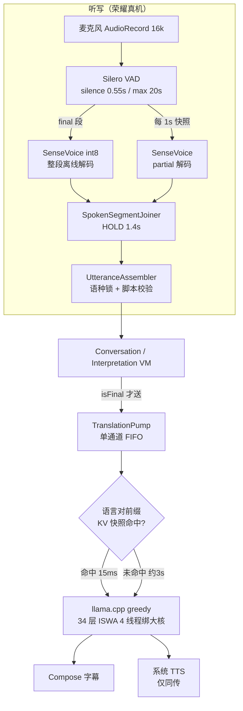

# 09 实现现状总览 · Android

本文是**代码的实况**，不是设计稿。

[`01`](01-product-prototype.md)–[`08`](08-on-device-llm.md) 写于实现之前，其中 `03`（技术选型）与 `04`（实现原理）描述的是当时的计划：**ML Kit 翻译 + Android `SpeechRecognizer`**。真机（荣耀 ALP-AN00）上这条路走不通，实现换成了 **sherpa-onnx SenseVoice 听写 + llama.cpp TranslateGemma 4B 翻译**。文档与代码不一致时，以本文为准。

测量环境：Honor ALP-AN00（Magic V2 同代），骁龙 8+ Gen 1，16 GB，MagicOS 8.0 / Android 14。2026-09-07 真机自检。

延迟专项见 [`10-latency-optimization.md`](10-latency-optimization.md)。

---

## 0. 一句话

一个纯端侧的多语言现场沟通 App：**SenseVoice 听写 → 语种路由 → TranslateGemma 4B 翻译 → 字幕/朗读**，四个模块（面对面、同声传译、会议记录、任务历史）共用任务与存储。主路径在荣耀真机上已经跑通，**翻译质量可接受，但端到端延迟偏大（约 2–2.7 s）**，这是当前最大的体验问题。

---

## 1. 与原设计的偏差（先看这个）

| 项 | `03`/`04` 写的 | 代码里实际是 | 影响 |
| --- | --- | --- | --- |
| 翻译引擎 | ML Kit Translation，六语语言包 | **llama.cpp + TranslateGemma 4B Q4_K_M**（2.49 GB GGUF），全 CPU | 六语都有，无 GMS 依赖；代价是 1.1–1.7 s/句 |
| 听写引擎 | `createOnDeviceSpeechRecognizer` + 语种检测 | 荣耀/华为 → **sherpa-onnx SenseVoice int8 + Silero VAD**；其余厂商 → `SpeechRecognizer` | 荣耀真机可用；非荣耀路径未经真机验证 |
| 语种路由 | 系统 `onLanguageDetection` 当主票 | **SenseVoice 自带 `lang` 标签 + 脚本推断**（`SenseTextRouter`/`SpokenText`），系统回调只在非荣耀路径 | 荣耀上没有系统回调这条路 |
| 翻译时机 | 部分结果节流送译（`FIRST_TRANSLATION_MS`/`TRANSLATION_MS`） | **只译 `isFinal`**，`if (!isFinal) return` | 见缺陷 D-2；`TranslationPolicy` 里那 4 个节流常量已成死代码 |
| 切句 | 系统静音窗口 extras | **Silero VAD 端点**（`minSilenceDuration = 0.55`）+ `SpokenSegmentJoiner` 缓冲 | 端点延迟 0.55 s，见缺陷 D-1 |
| 会后总结 | ML Kit GenAI / Gemini Nano 三态 | **`HonestSummarizer` 是桩**：`availability()` 恒为 `DeviceNotEligible`，`summarize()` 直接 `error()` | 总结功能等于没做，只能导出 |
| 音频策略 | 分场景 `UNPROCESSED` / `VOICE_COMMUNICATION` | **`AudioSessionPolicy.activate()` 三个 use case 完全同构**（都是 `MODE_NORMAL`），参数无效果 | 面对面关 AEC、同传读出开 AEC 都没实现 |
| 语言能力 | `checkRecognitionSupport` 动态目录 | `DeviceCapabilityProbe` 的 `installedSpeechLocales`/`supportedSpeechLocales` **恒为空集**，`DeviceLanguageCatalog` 退化成「中文/英文=true，其余=false」 | 同传选日语/韩语会被判不可用；泰语/越南语全链路不可用 |
| 模型包管理 | 按语言对下载 | 一个 4B GGUF 管全部语言对；`DeviceAssetCatalog` 里 `downloadLanguage/deleteLanguage` **写死 English** | 没有「按需下包」这回事 |

---

## 2. 运行时全貌



关键是三层串行：**VAD 端点 → 整段 ASR → 整句 LLM**。中间任何一层都没有「边听边出」的能力，这是延迟的结构性来源。

---

## 3. 模块实现程度

| 模块 | 状态 | 说明 |
| --- | --- | --- |
| 引导 Onboarding | ✅ 可用 | 欢迎→语言→麦克风权限→下载模型（进度权重：听写 0.12 / 翻译 0.88）。荣耀机下载 SenseVoice 240 MB + Gemma 2.49 GB |
| 首页 Home | ✅ 可用 | 三张模块卡 + 未结束任务入口；能力文案来自 `DeviceCapabilityProbe` |
| **面对面 Conversation** | ✅ 真机主路径 | 上下分屏，上屏 `rotate(180f)`；双向翻译；语种路由 + 串扰抑制 + `dropPrefix` 去重；`autoStartListening` 默认开 |
| **同声传译 Interpretation** | ✅ 可用 | 单栏；单向；不自动开听；TTS 队列上限 2、按增量后缀朗读；耳机门禁（`AudioDeviceCallback`） |
| 会议记录 Meeting | ✅ 可用 | 只转写不翻译；进入即 `translator.release()` 卸载 4B 腾内存；2 万字上限自动停 |
| 任务历史 History | ✅ 可用 | Room，左滑删，详情只读，导出 UTF-8 txt 走系统分享 |
| 会后总结 Summary | ❌ 桩 | 恒为「这台手机不能在本机生成摘要」。`ConversationViewModel` 里那段 summarize-and-save 是死代码 |
| 模型管理 Models | ⚠️ 半成品 | 能看进度/下载/删除；`asset.indeterminate` 恒为 false（分支死），翻译卡片只有一份（不按语言对） |

---

## 4. 分层（与设计一致）

```
app/         Hilt 组装、NavHost、Preferences、FeatureRegistry
features/    home · conversation · interpretation · meeting · history · onboarding · models · shared
domain/      CaptionModels(PaneState/SpokenText) · routing(Assembler/Joiner/Splitter/LanguageRouter)
             ServiceProtocols(全部接口) · TaskSessionController · TranslationPolicy · AppLanguage · Copy
services/    speech(SherpaSpeech/AndroidSpeechEngine/…) · translation(GemmaTranslator/TranslationPump/…)
             tts · persistence(Room) · summary(桩) · export · assets · audio(桩)
designsystem/ Tokens · Components · DuiyiTheme
```

单向依赖保持得不错：Feature 层没有出现 `SpeechRecognizer` / `AudioRecord` / `TextToSpeech` 类型名。`CameraStudio` 那类越界不存在。

---

## 5. 已完成 / 半成品 / 未实现

**已经做完且质量不错**
- SenseVoice + Silero VAD 的听写流水线（部分结果 1 Hz、final 段、8 s 环形缓冲、脚本校验、`UtteranceAssembler` 语种锁）
- TranslateGemma 前缀 KV 快照缓存 + 大核绑定（见 `08`，短句从 3.7 s → 1.1 s）
- 语种路由与字幕合并状态机（`PaneState` 的 `applyLive`/`applyTranslation`/`absorbRefinement`）
- 任务语义（新任务/暂停/结束/杀进程恢复/空任务不入历史）
- 荣耀机厂商差异的全部对策（`SpeechEnginePolicy` + 10 条单测）
- 多镜像断点续传下载器（hf-mirror → HF → ModelScope）

**半成品 / 桩**
- 总结（桩）、音频会话策略（空实现）、语言能力探测（空集）、模型按语言对管理（写死 English）、部分结果翻译（代码删了，常量还在）

**未实现**
- 非荣耀机型的真机验证（Pixel/三星路径只写了代码）
- 泰语 / 越南语任何引擎
- 无 GMS 机型的厂商识别接入

---

## 6. 已确认的缺陷（按影响排序）

### D-1 短句「永远不翻译」，直到用户再说一句 —— 高 —— **已修（待真机验证）**

`SpokenSegmentJoiner` 对不像句子的短句会先攒着（`HOLD_NS = 1.4 s`），等 `tick()` 超时释放。但 `tick()` 原先只有**一个调用点，位于解码循环内部、一次解码之后**：

```kotlin
val decoded = decodeSamples(rec, samples, primary)
if (decoded.first.isNotBlank()) emitAssembled(...)
joiner.tick(System.nanoTime())?.let(::sendPiece)   // ← 只有解码过才会走到这里
```

说话人一旦停下，VAD 不再产段、partial 也不再产生，解码循环阻塞在 `select` 上，`tick()` 再也不被调用。于是「好的」「Thank you」这类不满足 `isSentenceLike`（中文 ≥10 汉字 / 英文 ≥6 词或 ≥28 字母、或以标点结尾）的短句，**字幕只有原文，译文要等下一次有人说话才出现**。

单测 `SpokenSegmentJoinerTest.timeoutFlushesHeldShort` 是通过的 —— 它直接调 `tick()`，测不到调用点的问题。

**修法**：`SherpaSpeech.captions` 里加了一个 200 ms 的 ticker channel，并把它并进解码循环的 `select`，所以 `tick()` 不再依赖「有东西被解码」。自检与延迟探针可见 `joiner_hold` 是否稳定在 1400 ms 附近。见 [`10`](10-latency-optimization.md) 第 9 节。

### D-2 长句要等说完才出译文 —— 高

`enqueueTranslation` 里 `if (!isFinal) return`（`ConversationViewModel.kt:487`、`InterpretationViewModel.kt:486`）。加上 VAD 只在 0.55 s 静音后才切段，**连续说 15 秒不换气，就 15 秒没有任何译文**。这是「译文出来的慢」最直观的来源。

### D-3 模型 80 MB 就算下载完成 —— 中

`SherpaModelSpec.isComplete` 用 `minBytes`（80 MB）判定 239 MB 的 `model.int8.onnx` 是否就绪。一个截断到 100 MB 的文件会被当成 ready 交给 ONNX Runtime，报错点会跑到推理期而不是下载期。

### D-4 每次写盘重写整张字幕表 —— 中

`RoomTaskStore.append()` 每 250 ms 一次 `persist`，每次删掉该 task 的全部 `TranscriptEntity` 再全量插回。一场 45 分钟的会，O(n²)。

### D-5 诊断文件无上限增长 —— 低

`DuiyiLog` 与 `SpeechProbe` 都往 `filesDir` 追加，没有轮转、没有上限。`SpeechProbe` 每次语音启动都写一行。

### D-6 工程卫生

- `app/.cxx/`（395 个 CMake/ninja 中间产物）**被提交进了 git**，`.gitignore` 漏了这一条。
- `third_party/llama.cpp` 是**指向 `/Volumes/DevDisk/src/llama.cpp` 的符号链接**，那个目录不是 git 仓库、没有 tag。换台机器构建会静默走 `FetchContent` 下载 tag `b10775` —— **本机实际编译的 llama.cpp 版本和 fallback 不是同一个**，且无法复现。
- `TranslationSelfTestActivity` 是 `exported="true"` 且留在 release 包里。
- 死代码：`TranslationPolicy` 的 4 个节流常量、`InterpretationViewModel.debounceJobs`、`AssetCard.indeterminate` 分支、`Copy.translationPackBody` 等。

---

## 7. 后续方向

分三条线，详见 [`10-latency-optimization.md`](10-latency-optimization.md)。

1. **延迟**（最高优先）：D-1/D-2 是缺陷，先修；再评估流式回字幕、增量分段翻译、推理内核提速。
2. **诚实度**（中）：总结、音频策略、语言能力三处桩要么实现要么从 UI 撤掉。当前 UI 上「总结」按钮点下去只有一句话，容易读成 bug。
3. **工程**（低但便宜）：.cxx 移出版本控制、llama.cpp 固定版本、诊断文件轮转、Room 增量写。

真机清单仍然是灰的：**Pixel 8/9、一台三星、一台无端侧识别机** 都没跑过（`07` 的 M5 验收未完成）。
